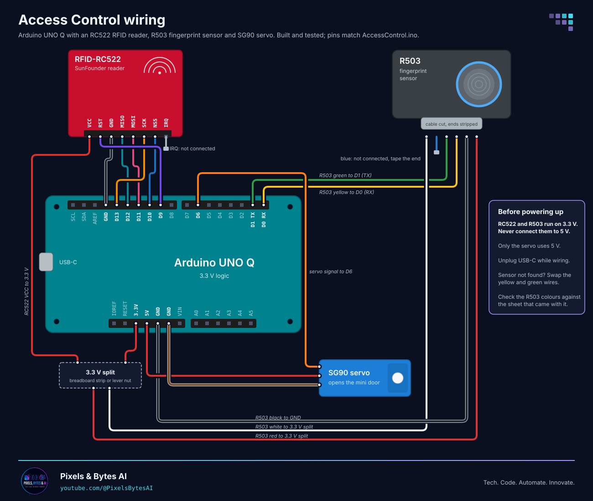

# Wiring

Connections between the Arduino UNO Q and the three parts it controls. Pin choices match `Code/AccessControl/AccessControl.ino`.

**Status:** built and working on a UNO Q with this exact pin map. The R503 wire colours come from third-party tutorials, not from Adafruit's own documentation. They matched our sensor, but check them against the sheet that came with yours.

## Before you start

- **The UNO Q's pins are 3.3 V logic.** Everything below either runs at 3.3 V or only receives a signal from the UNO Q, so no level shifter is needed.
- **Power the RC522 and R503 from 3.3 V, never 5 V.** 5 V can destroy the RC522.
- **Unplug USB-C while wiring.**

## Pin map

| UNO Q pin | Goes to | Notes |
|---|---|---|
| D0 (RX) | R503 yellow wire | Sensor's transmit line |
| D1 (TX) | R503 green wire | Sensor's receive line |
| D6 | Servo signal (orange) | |
| D9 | RC522 `RST` | |
| D10 | RC522 `NSS` (also labelled `SDA`) | |
| D11 | RC522 `MOSI` | |
| D12 | RC522 `MISO` | |
| D13 | RC522 `SCK` | |
| 3.3V | RC522 `VCC`, R503 red, R503 white | Three wires share this pin |
| 5V | Servo red | |
| GND | RC522 `GND`, R503 black, servo brown | The UNO Q has three GND pins, one each |

## Part by part

### R503 fingerprint sensor (6 wires)

| Wire | Function | UNO Q pin |
|---|---|---|
| Red | Power | 3.3V |
| Black | Ground | GND |
| Yellow | Data out of the sensor | D0 (RX) |
| Green | Data into the sensor | D1 (TX) |
| Blue | Finger-detect signal | Leave unconnected |
| White | Touch-sensing power | 3.3V |

If the console says the sensor was not found, swap the yellow and green wires.

### RC522 RFID reader (8 pins)

| RC522 pin | UNO Q pin |
|---|---|
| VCC | 3.3V |
| RST | D9 |
| GND | GND |
| MISO | D12 |
| MOSI | D11 |
| SCK | D13 |
| NSS | D10 |
| IRQ | Leave unconnected |

### SG90 servo (3 wires)

| Wire | UNO Q pin |
|---|---|
| Brown | GND |
| Red | 5V |
| Orange | D6 |

The servo lead is about 25 cm long. Extend it with three male-to-male jumper wires and pass them through the cable hole in the back of the access box.

## Sharing the 3.3V pin

The UNO Q has one 3.3V pin, but this build needs three 3.3 V connections. Use one of these to split it:

- A mini breadboard or a cut-down strip of one, stuck to the box floor.
- Lever-type splicing connectors.
- Soldered Y-leads.

## Things to check on first power-up

1. With only the UNO Q connected, upload the sketch and open the console. It should print "Access control ready".
2. Add the RC522. Tapping a card should print its ID.
3. Add the R503. The console should report the sensor ready, and the ring should glow blue.
4. Add the servo with the door frame off, and check which way it turns before fitting the frame.
