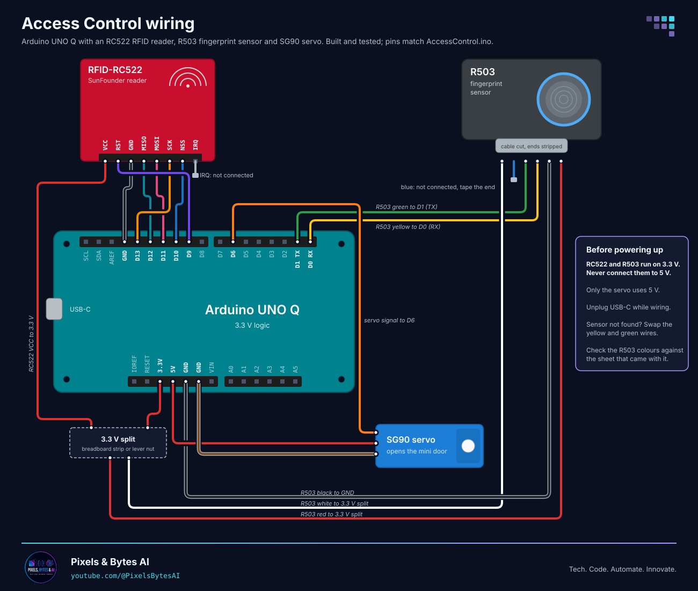

# Access Control Box

A 3D-printable fingerprint and RFID door-access demo built around the **Arduino UNO Q**. Tap a card or press a finger, and a servo swings open a miniature door.

It has two printed assemblies:

- **The access box:** a wall-mounted enclosure holding the UNO Q, an R503 fingerprint sensor and an RC522 RFID reader.
- **The mini door:** a desk-sized door that a micro servo swings open when access is granted.

*Render of the finished build. Colours and setting are illustrative.*

> Made by **Pixels & Bytes AI**. More builds on YouTube: [@PixelsBytesAI](https://www.youtube.com/@PixelsBytesAI)

## Status

- **Electronics and code:** working on a real UNO Q. Card access, fingerprint enrollment and fingerprint access all work.
- **Mini door:** printed and fully assembled. The frame fits and the servo swings the door open and closed.
- **Access box:**
  - A lid was printed, but the RC522 pocket was too tight, so it was lengthened to 62 mm. The fixed lid hasn't been printed yet.
  - The body is printed and the UNO Q mounts on its standoffs. The R503 is a perfect fit in the lid.

See [Known gaps](#known-gaps) for the details.

## What you need

**Electronics**

| Part | Notes |
|---|---|
| Arduino UNO Q | |
| Adafruit R503 fingerprint sensor | Runs on 3.3 V. The cable end is cut off and wired straight to the board. |
| RFID-RC522 reader (SunFounder) and cards or fobs | Runs on 3.3 V |
| Tower Pro SG90 micro servo | Runs on 5 V |
| Jumper wires, plus a way to split the 3.3 V pin three ways | A mini breadboard strip, lever connectors or soldered Y-leads |

**Hardware**

- 4 × M3 screws for the access box lid, about 10–12 mm long, threading directly into the plastic posts.
- 4 × small screws for the UNO Q standoffs (2.6 mm pilot holes; for M3 screws, drill them out slightly first).
- 2 × wall screws with heads under 8 mm across for the keyhole slots.
- The two mounting screws and horn screw that come with the SG90.
- Optional: 1 × M3 × 20 screw as the door's top pivot.

## Repository layout

| Path | What it is |
|---|---|
| `Code/AccessControl/` | The Arduino sketch, plus `MFRC522_bundled.h` (the RFID library, bundled; see [Uploading the sketch](#uploading-the-sketch)) |
| `Print Files/` | STLs for all printed parts |
| `3D files/` | Blender source (`Access_Control_Box.blend`) and renders |
| `Documentation/WIRING.md` | Pin-by-pin wiring, with a diagram (`wiring_diagram.svg`) |
| `Documentation/PROJECT.md` | Plain-language explanation of how the access control works |
| `Documentation/UNO_Q_NOTES.md` | What we learned about the UNO Q, App Lab and the MFRC522 library |
| `Documentation/FINGERPRINT_STORAGE.md` | How fingerprints are enrolled, stored and deleted |

## Printing

| File | Part | Size (mm) | Print orientation |
|---|---|---|---|
| `ACB_Body.stl` | Access box body | 100.8 × 128.8 × 40.4 | Back face on the bed |
| `ACB_Lid.stl` | Access box faceplate | 100.8 × 128.8 × 6.5 | Front face on the bed |
| `MD_Base.stl` | Mini door base, holds the servo | 110 × 56 × 28.7 | Upside down, top face on the bed |
| `MD_Frame.stl` | Mini door frame | 82.4 × 129.9 × 14 | On its back |
| `MD_Door.stl` | Mini door | 60 × 110 × 14 | On its back, knob up |
| `MD_Pin.stl` | Top pivot pin for the door | 7 × 7 × 21.5 | Head on the bed |

All STLs are in millimetres, already in print orientation, and need no supports.

**Suggested order:**
1. **Access box lid.** The lengthened RC522 pocket is the only fit not yet confirmed by a print.
2. **Mini door.** Check the horn pocket in its bottom edge against your servo horn before printing the base and frame.
3. Everything else.

In the Blender file, the printable parts are in the **Access Control Box** and **Mini Door** collections. Scene units are millimetres. The **Reference Parts (do not print)** collection holds coloured stand-in blocks for the electronics, used only to check fit.

## Wiring

Full details are in [Documentation/WIRING.md](Documentation/WIRING.md).

**Power the RC522 and R503 from 3.3 V, never 5 V.** Only the servo uses 5 V.

## Uploading the sketch

Upload with **Arduino App Lab**. The sketch prints through `Monitor`, which only shows in App Lab's Serial Monitor tab, not in the Arduino IDE's Serial Monitor.

1. Create an app in App Lab. In its `sketch` folder, set up two files:
   - `sketch.ino`: paste in the contents of `Code/AccessControl/AccessControl.ino`.
   - `MFRC522_bundled.h`: add it as a new file and paste in the contents of `Code/AccessControl/MFRC522_bundled.h`. The name must match exactly.
2. Add **Adafruit Fingerprint Sensor Library** and **Servo** to the app from App Lab's library panel. Arduino_RouterBridge is built into the UNO Q platform.
3. Click **Run** and open the **Serial Monitor** tab.

**Why the library is bundled:** App Lab hides the MFRC522 library because it doesn't list the UNO Q as a supported board. It's included here as one header file. It's public domain, by GithubCommunity.

**First-time setup:**
1. Tap each card or fob. Unknown cards print their ID in the Serial Monitor.
2. Paste one ID into `ADMIN_CARD` and the others into `ALLOWED_CARDS` near the top of the sketch, then click Run again.
3. To enroll a fingerprint, tap the admin card, then place the same finger on the sensor twice while the ring is purple.
4. To manage stored prints, type `list`, `delete <slot>` or `clear` into the Serial Monitor. Prints are stored in the R503, so they survive re-uploads.

**Ring light:** breathing blue when idle, solid blue when access is granted, flashing red when refused, purple while enrolling.

**If the door swings the wrong way,** swap `CLOSED_ANGLE` and `OPEN_ANGLE` in the sketch. Test with the door frame off. The defaults are 110° closed and 0° open.

UNO Q tips that cost us time are in [Documentation/UNO_Q_NOTES.md](Documentation/UNO_Q_NOTES.md):
- The R503 must use `Serial1`, not `Serial`.
- Code goes in `sketch/sketch.ino`.
- The R503 rejects the fast fingerprint search, so the sketch uses the standard one.

## How it works

1. Press a finger on the R503 or tap a card on the "tap here" mark over the RC522.
2. The UNO Q checks the card ID against its list, or asks the R503 to match the fingerprint against its stored prints.
3. On a match, the servo swings the mini door open, then closes it again after 4 seconds.

## Access box

*The electronics are drawn as simplified blocks and no wiring is shown. The lid is seen from behind, so it is mirrored left to right compared with the front.*

| Part | Where it goes | Size used in the model |
|---|---|---|
| Arduino UNO Q | Box floor, on four standoffs, USB-C through the left wall | 68.6 × 53.3 mm, standard UNO hole pattern |
| R503 fingerprint sensor | Lid, through a round hole, held by its own nut | 25.5 mm hole (thread about 25 mm, bezel about 28 mm) |
| RC522 reader | Underside of the lid, held by two snap clips | 62 × 40.6 mm pocket (board measured at 61.5 × 40.1 × 1.7 mm) |

**Body**

- Inner cavity 96 × 124 × 38 mm, 2.4 mm walls and floor.
- Four 6.5 mm standoffs for the UNO Q, tall enough to clear the connectors under the board.
- 14 × 8 mm USB-C opening in the left wall.
- A 35 × 27 mm tray on the floor, originally for a relay module and now unused.
- 10 mm cable hole in the back for the servo wiring.
- Two keyhole slots in the back for wall screws.
- Four corner posts with 2.8 mm pilot holes for the lid screws.

**Lid**

- 3 mm faceplate with a 3 mm locating lip.
- The R503 hole and the engraved "tap here" mark share one column, left of centre. The mark sits over the RC522 antenna.
- The RC522 pocket is notched and relieved 1.6 mm at the header end for the pins and solder joints. The clips leave a 1.9 mm gap for the 1.7 mm board.
- Four counterbored 3.4 mm holes for M3 screws.

**Assembly**

1. Screw the UNO Q onto its standoffs with the USB-C port at the wall opening.
2. Push the R503 through the lid from the front and tighten its nut from behind.
3. Slide the RC522 under one clip and press it past the other, plain side against the lid, header pins pointing right as seen from the front.
4. Wire everything to the UNO Q, feed the servo cable through the cable hole, and screw the lid on.

## Mini door

*The front of the base is cut away in this picture only, to show the servo.*

**Design**

- The servo is the hinge. It sits in the hollow base with its shaft pointing up at the hinge corner, and its two tabs screw to the underside of the base top.
- A pocket in the bottom edge of the door fits over the single-arm servo horn, so the horn turns the door.
- The top of the door pivots on a pin through the frame header.
- The frame posts plug into sockets in the base. A lip on the latch side stops the door swinging backwards.
- The door opens toward the front and sits 1.5 mm above the base.
- A notch in the back of the base lets the servo cable out.

**Assembly**

1. Screw the single-arm horn onto the servo with the arm pointing along the servo body.
2. Push the servo up into the base from below and fix it with its two small screws.
3. Press the door down onto the horn.
4. Lower the frame over the door into its sockets. Leave it unglued so it can come apart.
5. Drop the pin through the header into the door. An M3 × 20 screw works in place of the printed pin and is stronger.

## Known gaps

- **RC522 pocket:** lengthened from 61 mm to 62 mm after a test print was tight. The new length hasn't been printed yet.
- **UNO Q standoffs:** the 2.6 mm pilot holes were a little tight for M3 screws, so we drilled them out slightly. Do the same, or use a thread-forming screw.
- **Mini door horn fit:** the full assembly works with our SG90's single-arm horn, but SG90 horns vary between sellers. The pocket was sized for a hub about 7 mm across and an arm about 16 mm centre to tip. Check yours before printing.
- **Servo noise:** the servo is noisy while it moves.
- **R503 wire colours:** the colours in `WIRING.md` come from third-party tutorials. Check them against the sheet that came with your sensor.

## License

- **Code** (`Code/`): MIT License. `MFRC522_bundled.h` is the MFRC522 library by GithubCommunity, released into the public domain under the Unlicense.
- **3D models, renders and documentation:** [Creative Commons Attribution 4.0 (CC BY 4.0)](https://creativecommons.org/licenses/by/4.0/). You can share and remix them, including commercially, as long as you give credit.

See [LICENSE](LICENSE) for the full terms.
